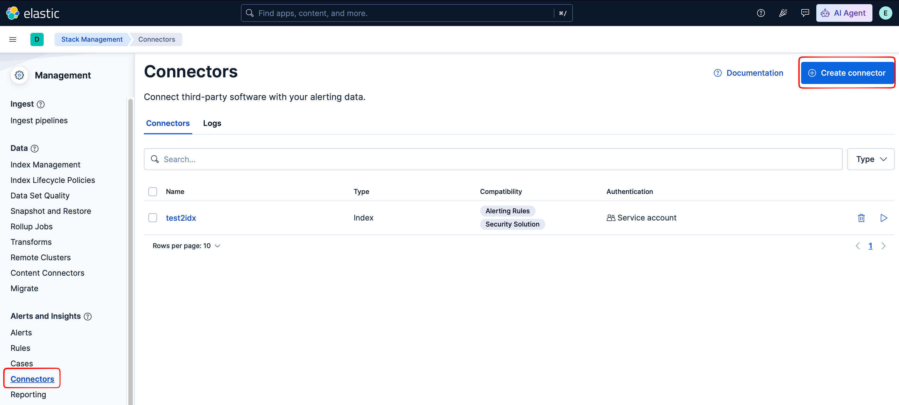
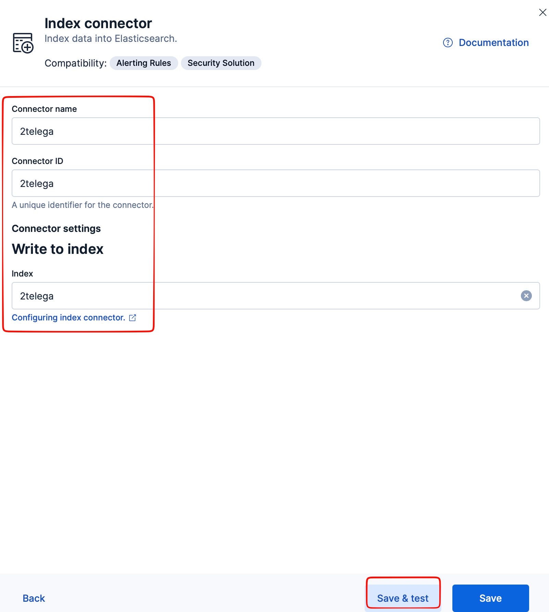
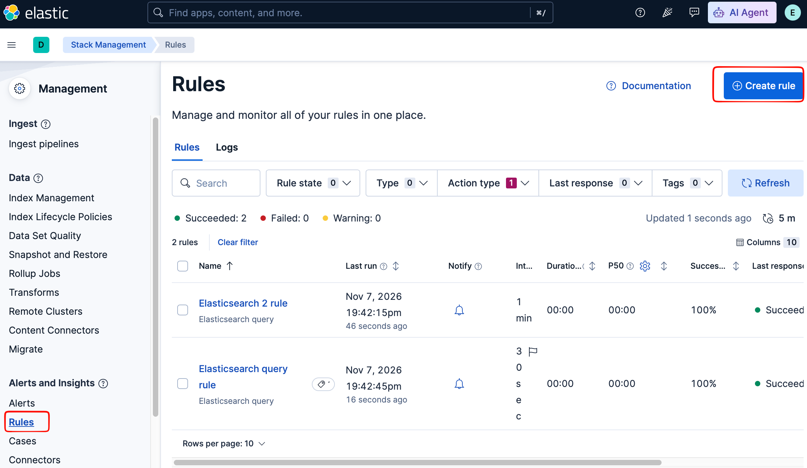
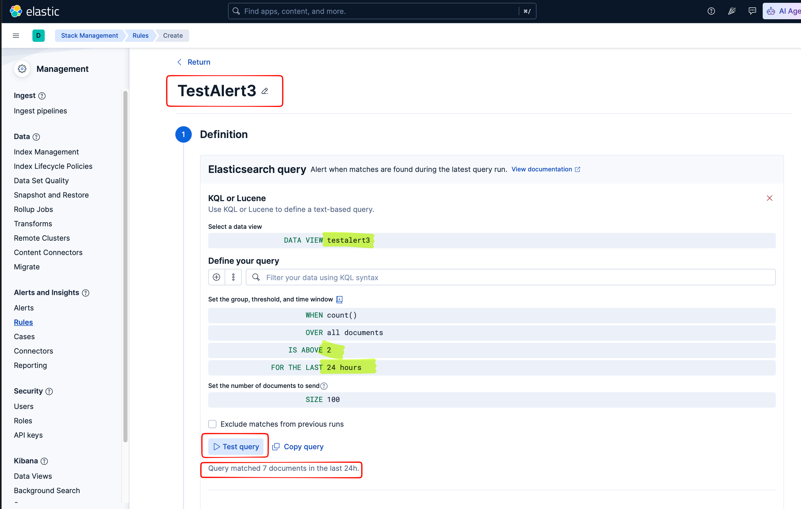
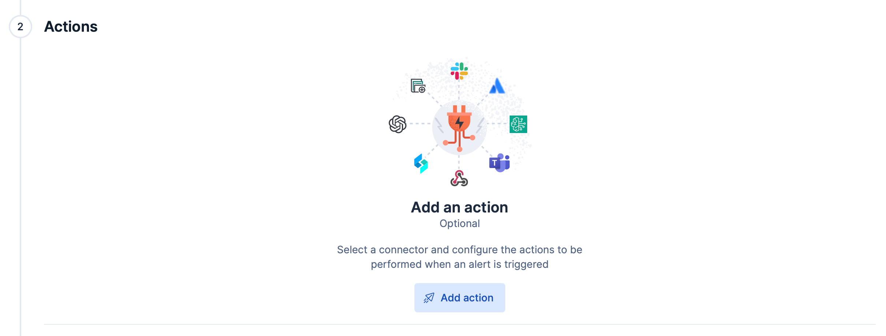
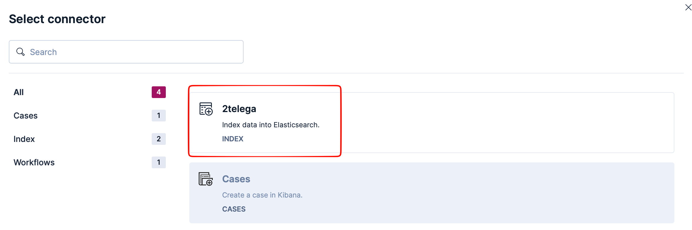
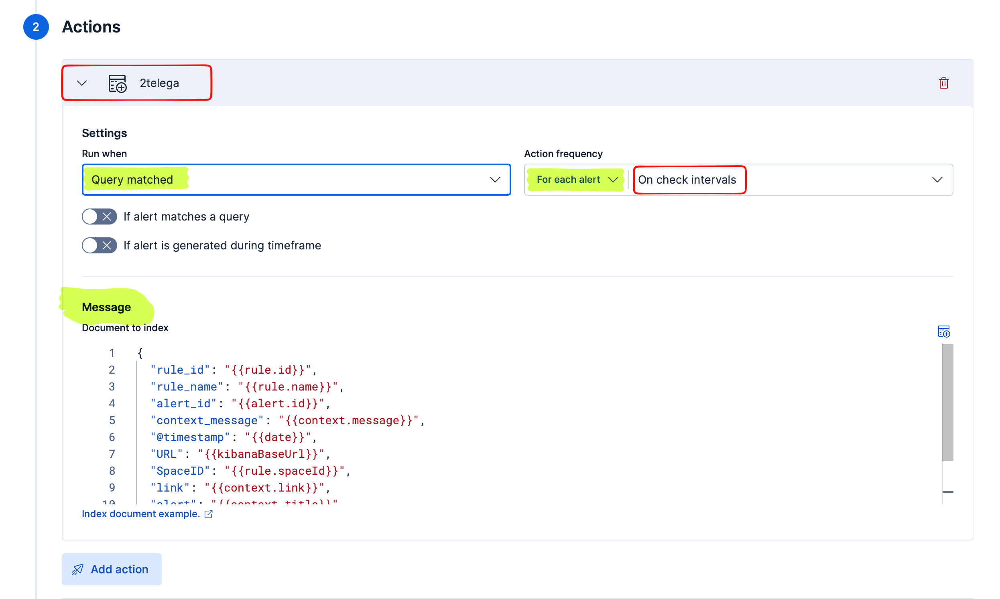
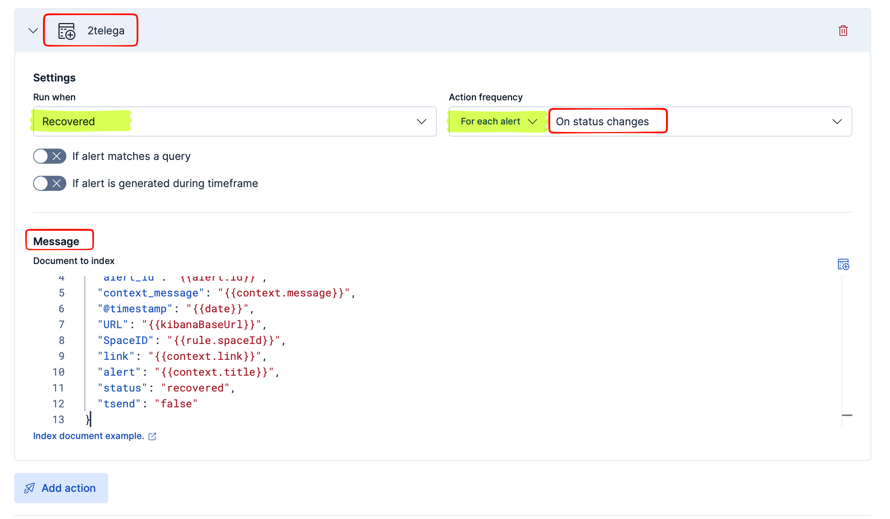

### Intro

Так короче... Есть у нас ELK от куда мы хотим срать алертами.
Че нам понадобится

1. Наш вайбговнокод на go
2. Телеграм бот созданый как обычно...
3. Датастрим в кибане куда будем складывать алерты.

### Наш вайбговнокод на go

Вообщем тут особо не ча распыляться я сложил эт чудо сюда:
https://github.com/ptmp13/TBotKibanaLogs

Ему надо несколько переменных окружения:
```bash
export ES_URL="https://your-elastic-host:9200"
export ES_INDEX="telegaalert"
export ES_API_KEY="your_api_key_here"
export TG_TOKEN="your_bot_token"
export TG_CHAT_ID="-100123456789"
export RULES_FILE="/opt/trololo.yaml"
export KIBANAURL=http://192.168.97.11:5601
```

Так же я накидал некий темплейтинг дескать че бум высирать в алерте:

```yaml
- rule_name: "default"
  title: "🚨 {{.SpaceID}} - {{.RuleName}}"
  recoveryTitle: "✅ Recovered: {{.SpaceID}} - {{.RuleName}}"
  message: |
    {{.ContextMessage}}
    URL: <a href="${KIBANAURL}{{.Link}}">link</a>
```

тут знач 
_rule_name_ - это имя должно соответствевать rule_name которое вы ебанули когда делали правило в kibana/terraform и тд. Ни как в телеге его не видно.
Дальше значит поля которые мы с телеге уже бум видеть:
_title_ - собстенно заголовок алерта
_message_ - сообщение в алерте
_recoveryTitle_ - заголовок если алерт разрезолвился
_recoveryMessage_ - сообщение если алерт разрезолвился

Можно использовать всякие поля которые нам дает эластик.  (но не все, хаха епты...).

Эт штука работает так типа оно групирует:

RuleName+SpaceID+Status если у них tsend: false то ебашим алерт.
Проставляем всем таким алертам дескать tsend: true. Если мы так не сделаем мы будем получать миллиард алертов на каждую запись которая прилетела пока наш бот отдыхал умирал а мы его "воскрешали".

На кой хуй так сделано, потому что у меня не получилось на одном event заставить ее нормално обновить запись в индексе, дескать алерт отрекаверился (т.е если мы пишем в индекс только на status change). Кто настраивал тот поймет.

### Телеграм бот созданый как обычно...

BotFather бла бла бла короче я хз че тут написать

### Датастрим в кибане куда будем складывать алерты.

Тут значит остановимся подробнее т.к. это основная часть которая нам нужна что бы эт работало.

#### Скаладываем тестовые данные

Идем в кибану и пуляем в некий индекс в данном случае __testalert3__ всякую хуйню:
дату сгенерить:
```bash
date -u +"%Y-%m-%dT%H:%M:%SZ"
```

```json
POST testalert3/_bulk
{ "index": {} }
{ "alert": 1, "@timestamp": "2026-11-07T16:34:52Z" }
{ "index": {} }
{ "alert": 1, "@timestamp": "2026-11-07T16:34:52Z" }
{ "index": {} }
{ "alert": 1, "@timestamp": "2026-11-07T16:34:52Z" }
{ "index": {} }
{ "alert": 1, "@timestamp": "2026-11-07T16:34:52Z" }
{ "index": {} }
{ "alert": 1, "@timestamp": "2026-11-07T16:34:52Z" }
{ "index": {} }
{ "alert": 1, "@timestamp": "2026-11-07T16:34:52Z" }
{ "index": {} }
{ "alert": 1, "@timestamp": "2026-11-07T16:34:52Z" }
```
Видимо чтов все заебись
```json
{
  "errors": false,
  "took": 405,
  ...
}
```

#### Создаем Template DataView для этого индекса куда будем пулять алерты.


#### Create alert rule

Создаем Connector в нашем случае индекс куда мы будем кидать алерты:




Можно просто __save__ в целом.

Создаем сам алерт:



Elasticsearch query rule ->

Тут переименовываем правило + добавляем че нам надо, что бы протестить эт чудо:


Сохраняем.

Че забыл добавить коннектор... идем обратно в влерт
__ТУТ ЕБАТЬ ВАЖНО__ че собственно будем писать в индекс!!!





json собстна (хуй знает может тут столько и не надо потом разберемся...)

```json
{
  "rule_name": "{{rule.name}}",
  "context_message": "{{context.message}}",
  "SpaceID": "{{rule.spaceId}}",
  "link": "{{context.link}}",
  "status": "{{alert.actionGroup}}",
  "tsend": "false"
}
```

__tsend__ - т.е мы типа еще не отправили в телегу.
__link__ - тут можно вкарячить че нить свое ссылку на какой нить дашборд.

Так же надо добавить Recovery Alert что бы когда ошибка пропадет нам прилетел алерт дескать все заебись


```json
{
  "rule_name": "{{rule.name}}",
  "context_message": "{{context.message}}",
  "SpaceID": "{{rule.spaceId}}",
  "status": "recovered",
  "tsend": "false"
}
```

__tsend__ - т.е мы типа еще не отправили в телегу. Остальное стандартное кроме 
__status__ - дескать эт recovered т.е восстановили/восстановилось.
__link__ - тут можно вкарячить че нить свое ссылку на какой нить дашборд.

Я тут пишу все эт для теста на самом деле эту штуку с алертами надо автоматизировать и добавлять терраформом.
Потому что понятно что копировать эту ебанину в каждое правило будет всем в падлу... а вот пулять терраформ где можно шаблонизировать часть этого говна, гораздо проще.

Короче заебало чет писать... потом допишу... когда настроение будет...
Да и в целом хули я все дописал почти..